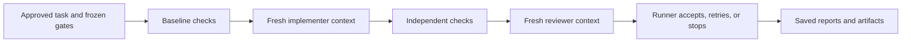

# AI Orchestrator

Delegate bounded coding tasks from Codex to your local Claude CLI. A deterministic
runner creates an isolated Git worktree, runs automated gates, manages fresh
implementation/review contexts, and returns a patch or a compact hosted-parent
escalation. Python standard library only; Linux/WSL, Python 3.12, Git, and Claude
Code are required.

## Use from Codex

From this maintained checkout:

```bash
python3 orchestrator.py install
```

This links the `local-coding-loop` skill into `$CODEX_HOME/skills` (or
`~/.codex/skills`) and installs `~/.local/bin/ai-orchestrator`. It does not overwrite
unrelated installations. Keep this checkout in place; updates apply to the linked
skill and launcher. Add `~/.local/bin` to PATH if needed, and open a new Codex
session to discover the skill.

Then ask Codex:

> Use $local-coding-loop to onboard this repository, then implement this change.

Codex prepares a reusable repository profile and a small task. The local model
implements and reviews while Codex waits for completion. Unresolved disputes get
one fresh local adjudication, then a saved parent packet. Codex can record a
per-finding decision and resume without waiving mandatory checks.

## Everyday commands

```bash
# Create a profile and short guide; configure real repository gates and setup.
ai-orchestrator init my-project --repo /path/to/project
ai-orchestrator doctor my-project

# Run one task or an independent queue, each in its own isolated worktree.
ai-orchestrator run my-project --task /path/to/task.json
ai-orchestrator queue my-project --task /path/to/one.json --task /path/to/two.json

# Read a summary, or resume a saved hosted-parent escalation.
ai-orchestrator status /path/to/run
ai-orchestrator resume /path/to/run --decision /path/to/decision.json
```

Profiles, guides, and artifacts live under `~/.local/share/ai-orchestrator`;
`AI_ORCHESTRATOR_HOME` overrides that location. `doctor` verifies dependency setup
and baseline gates in a fresh worktree without a model call. Fresh worktrees need
explicit dependency setup; existing uncommitted source changes are preserved and
excluded. Queues run independent tasks against one frozen committed base; they do
not compose patches or support dependent tasks automatically.

Accepted patches remain uncommitted, with final checks and exact content hashes.
The tool never automatically applies, merges, pushes, or deploys them. Exit codes
are 0 accepted, 1 failed/unresolved, and 2 parent decision required (`queue` returns
1 if any task is not accepted). Defaults are four implementation rounds, one valid
review, two review-format attempts, and one fresh opinion for repeated findings.
Limits are configurable. Resume supports saved escalations, not arbitrary crashes;
interrupted attempts retain evidence and need a fresh worktree.

See the [workflow reference](skills/local-coding-loop/references/workflow.md) for
profile/task schemas, independent acceptance checks, environment configuration,
and parent decisions. The implementation model has Bash access; worktrees and
guards are not an adversarial sandbox. Saved transcripts may contain private source.

## Verification

```bash
python3 -m unittest discover -s tests -v
```

Tests include CLI execution with a fake Claude executable, isolation from dirty
source checkouts, queue continuation, fresh adjudication, checkpoint/resume,
stale-source and contract rejection, scope enforcement, and final-check failure.
No inference server is needed for this suite.

The remaining sections document the original experiments and low-level runner.
Their machine-specific examples are retained for reproducibility; new repositories
should use the CLI and profiles above.

## Why this experiment exists

Can a slower local coding model handle bounded implementation work while a
separate deterministic runner owns scope, verification, and acceptance? This
repository investigates that question through saved experiment protocols and
results rather than assuming that model approval proves correctness.

**Status:** usable local tooling for trusted Linux/WSL work, with experimental
evidence below. Passing configured checks does not prove all product behavior or
establish a general cost advantage over hosted-only development.



## Evidence to read first

- [First trial](EXPERIMENT.md): initial outcomes and observed review failures.
- [Paired pilot](BENCHMARK-01.md): hosted-only versus hybrid workflow and usage caveats.
- [Three-task batch](BENCHMARK-BATCH-02.md): accepted and unresolved outcomes, including
  a reviewer rejecting valid work. The small sample does not establish general reliability.
- [Strategy](STRATEGY.md): directions informed by the experiments.

The [run instructions](#run) explain the dependencies and target-repository setup.
You can run the runner's unit tests without launching a coding experiment.

## Artifacts

- `team_lead.md`: bounded planning prompt for human-assisted onboarding.
- `prompts/implementer.md` and `prompts/reviewer.md`: execution personas.
- `configs/entourage.example.json`: editable example of the target, tools, timeouts, and required gates.
- `configs/entourage.json`: ignored local configuration created from the example.
- `configs/entourage-guide.md`: compact architecture and environment handoff.
- `configs/async-unittest-example.md`: concise framework and async-test conventions.
- `tasks/E001.json`: approved initial work order and allowed files.
- `runner.py`: deterministic state machine; agents do not own task status.
- `runs/<timestamp>-<task>/`: configuration/task snapshots, prompts, raw Claude
  output, reports, full check logs, round diffs, dialogue, and machine-readable state.

## Run

Requires Linux/WSL, Python 3.12, Git, and an installed Claude Code CLI.
The target repository needs its own dependencies and passing verification baseline.

For a new checkout, copy the example and edit the repository path, Linux Node bin
directory, and absolute acceptance-script path. Configure Claude authentication
through your environment or the explicitly named literal exports in the optional
`environment_file`. Never put credentials in tracked configuration.

```bash
cp configs/entourage.example.json configs/entourage.json
# Edit configs/entourage.json for your machine.
```

Then, from this folder:

```bash
python3 -m unittest discover -s tests -v
python3 runner.py --config configs/entourage.json --task tasks/E001.json
```

The target must start clean. The runner holds a repository lock, executes every
baseline gate, then alternates implementation and review with fresh contexts.
Checks run after each implementation. Failures go back to implementation; review
runs only once checks pass. The experiment requests at least two actual reviews (failed implementation rounds do not count)
(up to four implementation attempts), including a fresh response to an initial
approval. Reviewers must not manufacture criticism or changes merely to fill rounds.

Acceptance requires all gates passing, a valid review approval without findings,
no out-of-scope edits, and unchanged reviewed content after final verification.
Reviews have only Read/Glob/Grep tools. Implementers have Read/Glob/Grep/Edit/Write/Bash.
MCP servers are disabled for these invocations. Existing Claude settings, plugins,
and authentication otherwise remain in effect. No continuation/resume is used.

Accepted work remains as local differences in Entourage, with an `accepted.patch`;
this first version does not commit, merge, push, deploy, or advance to other tasks.
Failed or interrupted runs retain changes and logs for inspection and exit nonzero.
A subsequent run requires an explicitly prepared clean target; do not blindly reset
unrelated work. Timeouts terminate the invocation's process group. JSON status is
printed when the phase changes; a slow Claude phase may produce no terminal output.

## Entourage onboarding scope

The initial gate requires all server unit tests, all seven client test files,
Expo lint, and TypeScript checking. After implementation it additionally runs
an independent task-specific acceptance oracle in `acceptance/`; that oracle was
confirmed to fail on the original code. Reviewers receive complete numbered source and a compact handoff of open findings
and check results, without prior approval narratives. Every review must cover all
acceptance criteria and cite supplied source IDs. The runner records the exact
corresponding source in resolved reviews. Legacy exact-quote references remain
supported; missing or ambiguous quotes fail. Evidence and coverage errors are
reported together for a bounded retry. Resolved reviews are saved separately from
raw model output. These checks validate references, not the reviewer's reasoning. Implementers
are told to challenge false premises and preserve working behavior.

Orchestrator controls are fingerprinted
and must remain unchanged throughout a run. Linux Node is explicitly selected to avoid
Windows npm/UNC path problems. Run Python tests from `server/`.

Full Python lint/type checking, ingestion checks, live inference, device behavior,
and visual/semantic quality gates have not been onboarded. Existing check scripts
and tests are outside the allowed edit scope; only one middleware and one new test
file may change. Passing this experiment is not a claim that all product behavior
has been verified.

## Limitations and research background

This runner is for a trusted local model, not an adversarial sandbox. File guards
stop acceptance after unexpected changes; they cannot prevent arbitrary Bash from
making external changes. Do not run it against unrelated work or hostile code.
Review agreement from the same model is imperfect evidence. Task acceptance criteria
still need careful onboarding; ordinary regression checks alone cannot prove them.

The low-level runner consumes explicit task contracts. The Codex skill handles
preparation and onboarding; repository-specific checks still need to be configured.
Keep objectives small and establish a green baseline before delegating work.

## First trial

See [EXPERIMENT.md](EXPERIMENT.md) for results, timings, artifacts, and observed review failures.

Run logs, private environment files, and local configuration are excluded from Git.
The experiment report is published; its raw run artifacts remain on the original machine.

## Repeating an experiment

Use a separate clean Git worktree at the original base revision to preserve an
accepted local patch. Supply a separate ignored `configs/*.local.json` pointing at
that worktree. Provide dependencies there; the local trial shares the installed
Node modules and Python virtual environment through ignored symlinks, without
copying private runtime data. The runner still requires a clean target and stores
new artifacts separately. A single rerun is exploratory, not a controlled estimate
of model reliability or a guarantee of improvement.

See [EXPERIMENT-02.md](EXPERIMENT-02.md) for the second trial, including a stopped review-validation attempt.

See [EXPERIMENT-03.md](EXPERIMENT-03.md) for the unattended third trial and comparison.

See [EXPERIMENT-04.md](EXPERIMENT-04.md) for the new-task trial, which stopped on an inference timeout.

## Review source IDs

Review source packets now label each line with a short ID such as `[S1:20]`.
Reviewers cite `{"anchor":"S1:20"}`; the runner resolves the exact file, line, and
code into the saved review. Unknown, blank, and contradictory references fail.
This avoids asking the local model to reproduce escaped source strings. The legacy
unique-quote format remains supported for earlier fixtures. This changes reference
bookkeeping, not required test gates or the quality of reasoning required for review.

See [EXPERIMENT-05.md](EXPERIMENT-05.md) for E002 completion with stronger behavioral gates and source-ID reviews.

To reproduce the latest parser task, adapt `configs/entourage-page.example.json`
into an ignored local configuration and run:

```bash
python3 runner.py --config configs/entourage-page.local.json --task tasks/E002-v2.json
```

See [BENCHMARK-01.md](BENCHMARK-01.md) for the first hosted-only versus hybrid paired pilot and measured usage caveats.

See [BENCHMARK-BATCH-02.md](BENCHMARK-BATCH-02.md) for the three-task batch and post-batch rebuttal-handoff fix.

See [STRATEGY.md](STRATEGY.md) for consolidated directions,
[DISPUTE-STUDY.md](DISPUTE-STUDY.md) for dispute replay/escalation evidence and usage,
and [PREPARATION-STUDY.md](PREPARATION-STUDY.md) for the paired short-vs-detailed brief trial.
